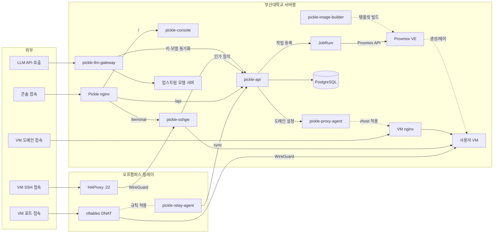

# pickle-image-builder

부산대학교 클라우드 플랫폼(Pickle)의 사용자 VM OS 이미지를 만드는 빌드 레시피예요.

사용자 VM을 복제할 Proxmox 템플릿의 빌드 설정을 담아요. 운영자가 하이퍼바이저
호스트에서 빌드한 뒤 OS 카탈로그에 등록하면 플랫폼에서 사용할 수 있어요.

## 동작 방식

- **빌더 하나에 OS마다 프로파일 하나**: 배포판 차이는 코드 분기가 아니라
  `profiles/`의 값으로 관리해요. 새 OS는 프로파일을 추가하고, 기존 항목으로 표현할 수
  없는 차이가 있으면 프로파일 형식과 빌더를 함께 확장해요.
- **프로파일은 격리해 읽어요.** 프로파일은 셸 파일이고 빌더는 하이퍼바이저에서
  root로 돌기 때문에, 빈 환경의 하위 셸에서 실행해 정해진 항목만 가져와요.
  프로파일이 무엇을 대입하든 빌더의 VMID나 재빌드 여부에는 닿지 않아요.
- **업스트림 이미지는 릴리스 채널에서 받아요.** 특정 빌드를 고정하지 않으므로
  다시 빌드하면 그동안 쌓인 보안 수정이 함께 들어와요.
- **체크섬은 매 빌드마다 대조해요.** 캐시된 이미지도 업스트림 체크섬과 비교해요.
  이미지와 체크섬의 출처가 같으므로 별도의 공급망 검증을 대신하지는 않아요.
- **작업 사본을 고쳐요.** 검증된 원본은 캐시에 남겨 다음 빌드가 다시 내려받지
  않게 하고, 커스터마이즈는 복사본에서만 일어나요.
- **기존 템플릿은 마지막에 지워요.** 내려받기와 검증, 이미지 커스터마이즈가 모두
  끝난 뒤에야 옛 VMID를 지우므로, 도중에 실패한 재빌드는 노드에 있던 템플릿을
  그대로 남겨요.
- **VMID는 템플릿 대역만 받아요.** 1000부터 9999까지가 그 대역이고, 벗어난 값은
  무엇이 실행되기도 전에 거부해요.
- **다시 빌드할 때는 게스트 이름도 확인해요.** 같은 VMID에 다른 이름의 게스트가 있으면
  중단해요.
- **한 번에 한 빌드만 실행돼요.** 동시에 돌면 같은 내려받기 경로를 두고 겹쳐요.
- **빌드마다 매니페스트를 남겨요.** `manifests/`에 템플릿별 빌드 재료를 기록하고,
  같은 내용을 게스트 안에도 보관해요.
- **접속 화면에 사용 안내를 보여줘요.** sudo의 비밀번호 입력과 재부팅 필요 여부,
  디스크 부족을 안내해요. 템플릿 변경은 이미 만들어진 VM에는 반영되지 않아요.
- **게스트 계정은 클라우드 이미지의 기본 사용자를 그대로 사용해요.** 플랫폼도 같은
  이름을 cloud-init에 넘기므로 템플릿 혼자 정하는 값이 아니에요.
- **템플릿의 host key를 지워요.** 클론마다 새 키를 만들 수 있도록 빌드 마지막에
  host key가 남아 있지 않은지 확인해요.
- **sshd와 sudo의 실제 동작을 확인해요.** sshd의 실효 설정을 읽고, 기본 사용자로
  sudo를 실행해 비밀번호를 요구하는지 확인해요. sudo 시험은 비밀번호 없는 기준
  실행도 먼저 확인해 다른 실행 오류와 구분해요.
- **부팅 복구 경로를 남겨요.** 시리얼 콘솔에 GRUB 메뉴를 3초간 보여줘요.
  SSH가 실행되지 않으면 웹 터미널도 사용할 수 없으므로 복구에는 이 콘솔을 사용해요.
- **패키지 설치와 자동 갱신의 대기 화면을 줄여요.** 설정 파일 충돌과 서비스 재시작을
  묻는 프롬프트, 첫 로그인 중 정기 작업 실행을 조정해요.
- **작은 게스트에 맞게 기본값을 조정해요.** 파일 감시 한도와 커널 패닉 후 재부팅,
  저널과 코어 덤프 상한을 설정해요. 필요한 배포판은 `/tmp`를 디스크에 둬요.
- **첫 부팅의 패키지 업그레이드를 꺼요.** 보안 갱신은 게스트의 자동 업데이트 일정에
  따라 실행해요.

## 시작하기

```
scripts/verify.sh         # shellcheck + 주소 위생 + 프로파일 검사

scripts/build.sh <프로파일> <vmid>             # 템플릿 빌드
scripts/build.sh <프로파일> <vmid> --rebuild   # 기존 VMID를 지우고 다시 빌드
```

빌드는 Proxmox 노드에서 root로 실행해요. `curl`, `flock`, `git`, `qm`이 필요하고
`libguestfs-tools`가 없으면 설치해요. 캐시가 이미 있어도 체크섬을 받아야 하므로
**매 빌드마다 업스트림에 접근할 수 있어야 해요**. 인자 없이 실행하면 사용법과 가진
프로파일 목록을 출력해요.

빌드가 남기는 것은 캐시 디렉터리의 검증된 원본 이미지와 잠금 파일이에요. 프로파일이
릴리스 채널을 가리키면 파일 이름이 그대로라 덮어쓰이고, 특정 빌드를 가리키면 하나씩
쌓여요. `--rebuild`는 `qm destroy --purge`를 쓰므로 그 VMID의 백업과 복제
작업도 함께 사라져요.

새 프로파일에는 `# shellcheck shell=bash` 줄이 필요해요. 없으면 `verify.sh`의 셸
린트가 거부해요.

빌드가 끝나면 `manifests/<프로파일>-<vmid>.json`이 갱신돼요. 실제로 쓰는 템플릿을
만들었다면 이 파일을 그 빌드의 커밋에 함께 담고, 시험 삼아 만든 것이라면 템플릿과 같이
지워요. 담기는 값은 업스트림 이미지 주소와 체크섬, 설치한 패키지, 레시피 리비전,
빌드 시각이에요. 작업 트리에 커밋하지 않은 변경이 있으면 리비전 뒤에 표시가 붙어요.

빌드만으로는 콘솔에 나타나지 않아요. 템플릿을 가리키는 OS 카탈로그 행을 심는 것은
운영자 등록 절차이고, 그 절차가 넣는 행은 비활성 상태로 들어와요. 관리자가 활성으로
바꾸기 전까지 이 템플릿은 신청 화면의 OS 목록에 없어요.

`verify.sh`는 커밋 전마다 실행해요. 셸 린트에 더해 공개 레포지토리 규칙을 검사하고,
프로파일을 빌더와 똑같은 방식으로 읽어 같은 규칙으로 검사하고, IPv4 주소 리터럴이
문서화 대역(RFC 5737)이나 루프백처럼 어느 호스트도 가리키지 않는 값이 아니면
실패해요.

## 구성

빌드할 때 환경 변수로 덮어쓸 수 있는 값이에요.

| 변수 | 기본값 | 설명 |
|---|---|---|
| `STORAGE` | `local-lvm` | 템플릿 디스크를 올릴 Proxmox 스토리지 |
| `BRIDGE` | `vmbr2` | `net0`에 붙일 브리지 |
| `IMAGE_CACHE_DIR` | `/var/cache/pickle-image-builder` | 업스트림 이미지 캐시 위치 |

프로파일이 담는 값이에요. 선택 표시가 없는 항목이 비어 있으면 `verify.sh`와 빌더가
모두 거부해요.

| 항목 | 설명 |
|---|---|
| `OS_FAMILY` / `OS_VERSION` | OS 카탈로그가 쓰는 계열과 버전 |
| `TEMPLATE_NAME` | 템플릿 이름 |
| `IMAGE_URL` / `CHECKSUM_URL` / `CHECKSUM_ALGO` | 업스트림 이미지와 그 체크섬 |
| `CIUSER` | 게스트 관리 계정 (클라우드 이미지의 기본 사용자). 환경 변수로 덮어쓸 수 없어요 |
| `SUDO_GROUP` | sudo 권한을 주는 그룹. 규칙이 계정이 아니라 그룹을 가리키므로 계정명이 달라져도 규칙이 살아 있어요. 빌드가 그 그룹이 이미지에 있는지, cloud-init이 기본 사용자를 그 그룹에 넣는지 확인해요 |
| `CPU_TYPE` | 템플릿 CPU 모델. ISA 하한을 올린 배포판은 더 높은 값이 필요해요 |
| `GUEST_PACKAGES` | 이미지에 설치할 패키지. 쉼표로 구분해요 |
| `SSHD_DROPIN_REMOVE` | (선택) 배포판이 넣어 둔 sshd 드롭인 중 지울 것 |
| `CHECKSUM_FORMAT` | (선택) `gnu`(기본) 또는 `bsd`. Red Hat 계열은 `SHA256 (파일) = 해시` 형식이에요 |
| `TMP_ON_DISK` | (선택) `yes`면 `/tmp`를 tmpfs로 올리는 배포판에서 그 유닛을 막아 디스크에 둬요. 기본은 `no`, 즉 배포판 기본값 그대로. 빌드가 그 유닛이 실제로 있는지 확인해요 |
| `GUEST_COMMAND` | (선택) 공통 설정을 다 넣은 뒤 게스트 안에서 한 번 실행할 명령. 배포판 하나에만 필요한 처리를 빌더 본문에 조건문으로 넣지 않기 위한 자리예요 |

## 게스트 진단 스크립트

`guest/pickle-diag.sh`는 VM 안에서 실행하는 읽기 전용 진단 스크립트예요. 부하,
메모리, 디스크, 실패한 서비스, 상위 프로세스, 네트워크 상태를 한 번에 출력해 지원
문의에 붙일 스냅샷을 만들어요. 아무것도 바꾸지 않고 상주하지도 않으며, 기본
유틸리티만 사용해요. 설치 없이 이미 만들어진 VM에서도 실행할 수 있어요.

```sh
curl -fsSL https://raw.githubusercontent.com/PNUops/pickle-image-builder/main/guest/pickle-diag.sh | bash
```

최종 갱신: 2026-11-08

## 전체 아키텍처

<!-- arch:begin -->


| 레포지토리 | 역할 |
|---|---|
| [pickle-api](https://github.com/PNUops/pickle-api) | REST API와 프로비저닝 워커 (Spring Boot 4, Java 25, PostgreSQL 18, JobRunr) |
| [pickle-console](https://github.com/PNUops/pickle-console) | 사용자·관리자 웹 콘솔 (React 19, TypeScript) |
| [pickle-sshgw](https://github.com/PNUops/pickle-sshgw) | SSH 게이트웨이와 웹 터미널 브리지 (sshpiperd, Go) |
| [pickle-proxy-agent](https://github.com/PNUops/pickle-proxy-agent) | nginx 리버스 프록시 제어 에이전트 (Go) |
| [pickle-relay-agent](https://github.com/PNUops/pickle-relay-agent) | 오프캠퍼스 릴레이의 nftables DNAT 에이전트 (Go) |
| [pickle-llm-gateway](https://github.com/PNUops/pickle-llm-gateway) | 교내 LLM API 게이트웨이 (Go) |
| [pickle-image-builder](https://github.com/PNUops/pickle-image-builder) | 사용자 VM OS 이미지 빌드 레시피 (shell, virt-customize) |
| [pickle-infra](https://github.com/PNUops/pickle-infra) (비공개) | 인프라 프로비저닝 스크립트와 운영 런북 (shell) |
| [pickle-infra-example](https://github.com/PNUops/pickle-infra-example) | 프로비저닝·배포 스크립트와 런북 샘플 |
| [pickle-secrets](https://github.com/PNUops/pickle-secrets) (비공개) | 호스트 시크릿 볼트 (git-crypt) |
| [pickle-secrets-example](https://github.com/PNUops/pickle-secrets-example) | 볼트 레이아웃과 git-crypt 운용 절차 |
<!-- arch:end -->
